Written for: engineers and reviewers reading this repository for the first time.

# System Architecture

A teacher-facing student information assistant for a third-year CSBS department.
This document explains how the system is put together and, where a decision was
not obvious, why it was made that way.

> All student records in this system are **synthetic**. Authentication is a
> **demonstration selector**, not real authentication. See
> [Security model](#6-security-model).

---

## Contents

1. [The one-paragraph version](#1-the-one-paragraph-version)
2. [System context](#2-system-context)
3. [Component architecture](#3-component-architecture)
4. [Data model](#4-data-model)
5. [Request lifecycle](#5-request-lifecycle)
6. [Security model](#6-security-model)
7. [AI architecture](#7-ai-architecture)
8. [Streaming protocol](#8-streaming-protocol)
9. [Calculation semantics](#9-calculation-semantics)
10. [Deployment topology](#10-deployment-topology)
11. [Design decisions](#11-design-decisions)

---

## 1. The one-paragraph version

A Next.js frontend talks to a FastAPI backend over HTTPS with a signed session
cookie. The backend resolves each teacher's permitted subjects from the database
on **every** request, then serves only records inside that scope. An AI assistant
answers natural-language questions by calling a fixed set of thirteen
database-backed tools — never SQL — each of which re-checks authorization before
reading. Model responses stream token-by-token over Server-Sent Events. The model
provider is chosen per request from the teacher's own API key, or from a single
server-configured fallback.

---

## 2. System context

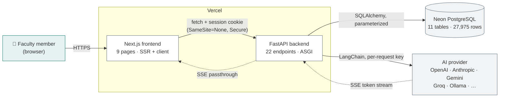

**Trust boundaries.** The browser is untrusted: it supplies a session cookie and
nothing else that matters. The frontend never decides what a teacher may see —
it renders what the backend returns. The AI provider is untrusted with respect to
authorization: the model can *ask* for any subject, and the backend refuses
anything outside scope.

---

## 3. Component architecture

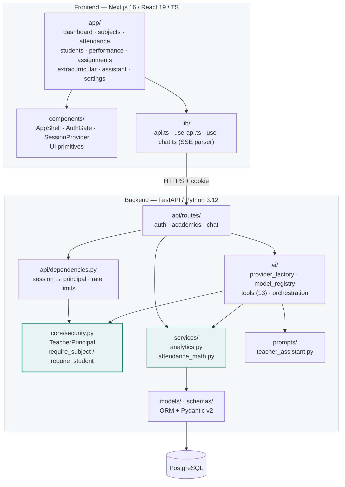

Two things are deliberate here:

- **`core/security.py` is the only place authorization is decided.** Routes and
  AI tools both call into it. There is no second implementation to drift.
- **`services/` is shared by routes and AI tools.** The number a teacher sees on
  the dashboard and the number the assistant quotes come from the same function,
  so they cannot disagree.

### Directory map

```
backend/app/
├── main.py                 app, CORS, body-size limit, security headers
├── api/
│   ├── routes/             auth.py · academics.py · chat.py
│   └── dependencies.py     current_teacher, rate limiters
├── core/
│   ├── config.py           settings (env-driven)
│   ├── db.py               engine, session, Base
│   ├── security.py         ★ TeacherPrincipal + all scope checks
│   └── logging.py          credential-redacting log filter
├── models/                 11 SQLAlchemy tables + CHECK constraints
├── schemas/                Pydantic v2 request/response models
├── services/
│   ├── attendance_math.py  ★ exact Fraction arithmetic
│   └── analytics.py        all business queries
├── ai/
│   ├── provider_factory.py build a chat model; SSRF-validated endpoints
│   ├── model_registry.py   per-provider capabilities
│   ├── tools.py            ★ 13 scoped tools; no SQL tool
│   └── orchestration.py    tool loop + SSE streaming
└── prompts/
    └── teacher_assistant.py  versioned system prompt
```

---

## 4. Data model

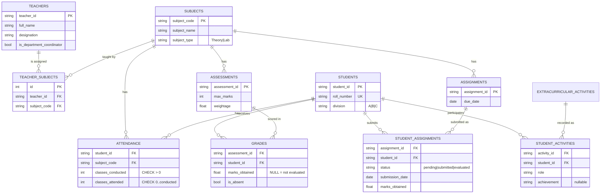

`TEACHER_SUBJECTS` is the **authorization table**. It is the single source of
truth for what a teacher may see, read fresh on every request. Subject-to-faculty
mapping appears nowhere else — not in the frontend, not in a config file, not in
the AI prompt.

### Invariants enforced by the database

Application bugs cannot violate these, because PostgreSQL rejects the write:

```sql
CHECK (classes_conducted > 0)
CHECK (classes_attended BETWEEN 0 AND classes_conducted)
CHECK (status IN ('pending','submitted','evaluated'))
CHECK (marks_obtained IS NULL OR marks_obtained >= 0)
UNIQUE (student_id, subject_code)      -- one attendance row per pair
UNIQUE (teacher_id, subject_code)      -- no duplicate assignments
```

---

## 5. Request lifecycle

Every data request takes the same five steps. Nothing short-circuits them.

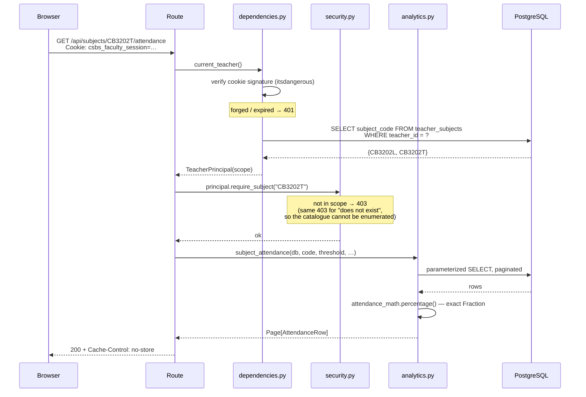

**Why the scope is re-read every request** rather than baked into the cookie: a
cookie issued before a teaching assignment changed would carry stale permissions
until it expired. Reading from `teacher_subjects` costs one indexed query and
makes revocation immediate.

---

## 6. Security model

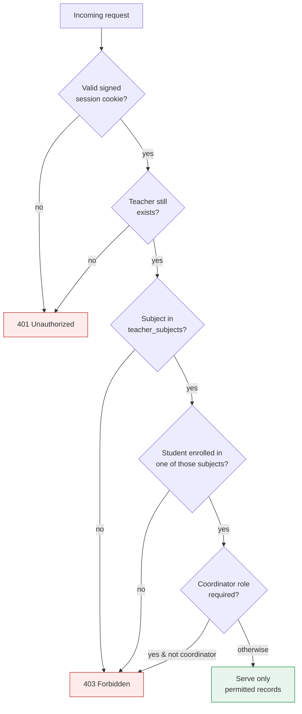

### What is never trusted

| Input | Treatment |
|---|---|
| `teacher_id` in a body, query or chat message | **Ignored.** Identity comes only from the signed cookie. |
| `subject_code` in a URL | Validated by regex, then checked against the DB scope. |
| `student_id` in a URL | Checked for enrollment in a subject the teacher teaches. |
| A `system` role in the chat transcript | Rejected by the Pydantic schema (422). |
| Text inside tool results or student records | Treated as data. It cannot grant permissions. |
| A model's choice to call a tool | The tool re-checks scope itself before reading. |

### Defence in depth

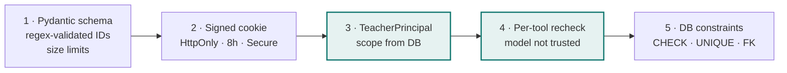

The system prompt is a **behavioural** control, not a security control. If the
model ignored every instruction in it, the tools would still refuse out-of-scope
reads. This is verified by tests that call tools directly, bypassing the model.

### Credential handling

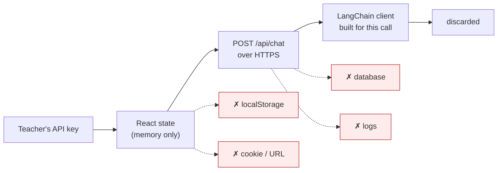

A regex filter on every log record redacts API-key and connection-string shapes,
and `sanitize_provider_error()` replaces raw SDK exceptions — which routinely
echo the `Authorization` header — with actionable text.

---

## 7. AI architecture

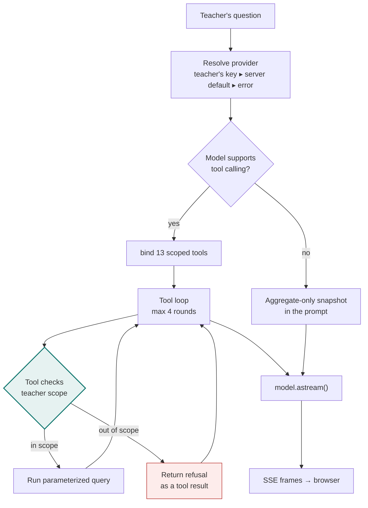

### The thirteen tools

There is **no SQL tool and no write tool**. Each is a fixed operation bound to one
`TeacherPrincipal` and one database session.

| Area | Tools |
|---|---|
| Scope | `get_teacher_subjects` · `find_students` |
| Attendance | `get_subject_attendance_summary` · `get_low_attendance_students` · `get_student_attendance` · `get_classes_needed_for_target` |
| Academic | `get_subject_performance_summary` · `get_students_below_marks_threshold` · `get_student_academic_summary` |
| Assignments | `get_assignment_submission_summary` · `get_student_assignment_status` |
| Extracurricular | `get_extracurricular_summary` · `get_student_extracurricular` |

Results are capped at 40 rows and **disclose truncation**, so the assistant cannot
claim to have analyzed everyone when it saw a subset. Tool results also carry the
relevant definitions — the threshold used, what "overdue" means, how missing marks
were handled — so the model restates them accurately instead of guessing.

### Provider abstraction

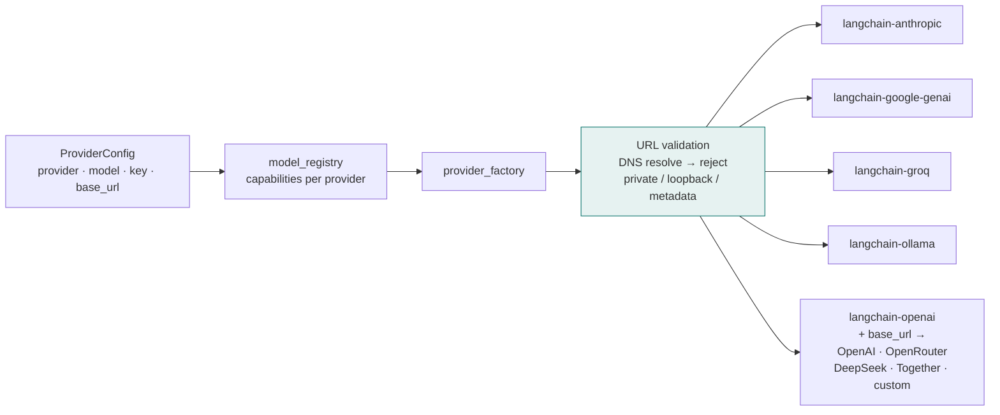

Five OpenAI-wire-compatible services share one client with a different `base_url`,
so adding another is a registry entry, not new code.

---

## 8. Streaming protocol

Tokens are forwarded as the provider emits them. Nothing is buffered to
completion; there is no simulated typing.

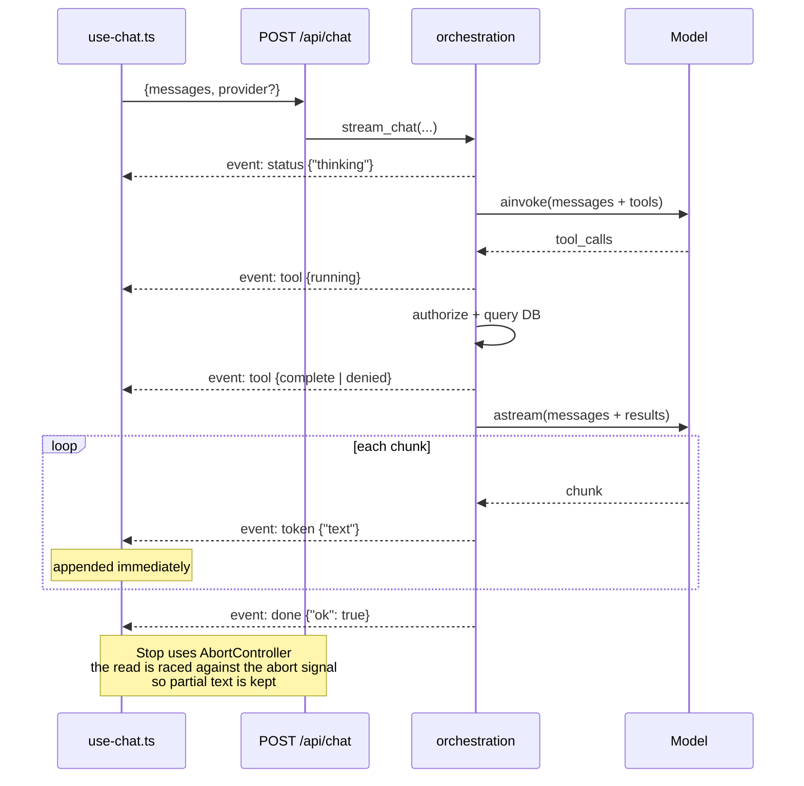

| Event | Payload | Client behaviour |
|---|---|---|
| `status` | `{state}` | Show "thinking" / "generating" |
| `tool` | `{name, state}` | Badge; `denied` renders in red |
| `token` | `{text}` | Append to the message |
| `error` | `{message, kind}` | Show error + Retry. **Never fabricate.** |
| `done` | `{ok}` | Finish and clean up |

A failed provider call surfaces the failure. It is never replaced with invented
text — a property covered by tests.

---

## 9. Calculation semantics

### Attendance — exact arithmetic

All attendance maths lives in `services/attendance_math.py` and uses `Fraction`,
not floats, so `30/40` is *exactly* 75% and is **not** flagged as below a 75%
threshold.

```
percentage = classes_attended / classes_conducted × 100

classes needed to reach target T:
    n = max(0, ⌈(T·C − A·100) / (100 − T)⌉)
```

A target of 100% after any absence raises an error rather than returning a
misleading number.

### Two averages, both labelled

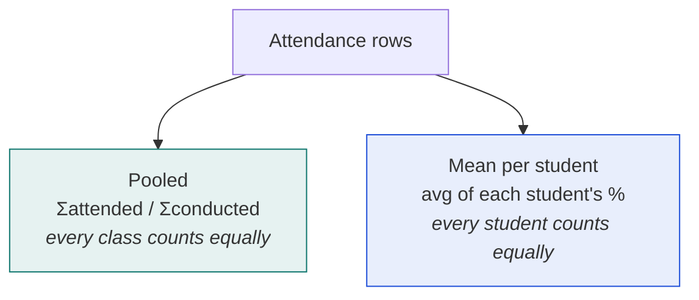

These differ whenever subjects have different class counts, so the UI shows both
with their definitions rather than one unlabelled "average".

### Three distinctions the system refuses to blur

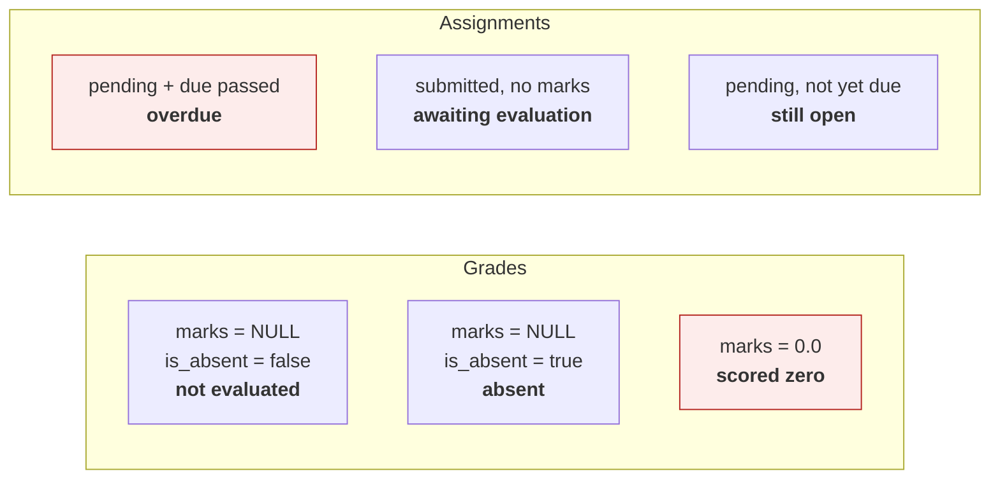

Unevaluated work is **excluded from the denominator**, never counted as zero.
Work submitted but not yet marked is **never** reported as overdue. The dataset
deliberately contains all three grade states so the distinction is exercised
against real data, not only in fixtures.

---

## 10. Deployment topology

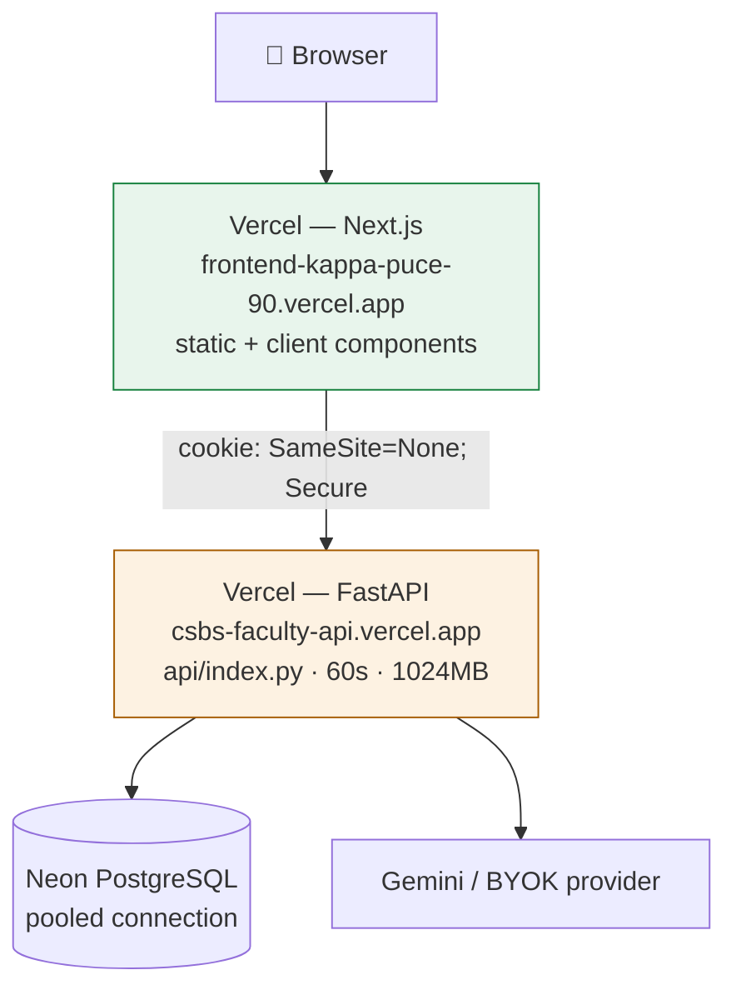

**The backend runs on serverless with real constraints**, measured rather than
assumed:

| Works | Constrained |
|---|---|
| Health, sessions, cookies | SSE capped at 60 s — a long turn can truncate |
| All data endpoints | Pool cannot persist; a **pooled** Neon string is required |
| Authorization (401/403) | Rate limiter is per-instance, so limits are weaker |
| Tool calling and streaming | Cold starts add latency |

`backend/render.yaml` and `backend/Dockerfile` run the same code on a container
host, where streaming and pooling behave as designed. No code changes needed.

---

## 11. Design decisions

### Why no vector database, RAG or agent graph

This data is relational. "Which students are below 75% in CB3202T?" is an indexed
`WHERE` clause with exact arithmetic — a vector store would make it slower, less
accurate and harder to authorize. Embeddings also break the scope model: you
cannot easily express "only this teacher's subjects" over a similarity search.
Database-backed tools are the correct design here, and adding retrieval
infrastructure would have been decoration.

### Why tools instead of generated SQL

A text-to-SQL tool would mean the model composing queries against a schema it
could be talked into misreading, with authorization enforced by prompt text. The
fixed tool set means the set of possible queries is finite, reviewable, and each
one re-checks scope in code.

### Why the scope is re-read per request

Cost: one indexed query. Benefit: permission changes take effect immediately
rather than when a cookie expires.

### Why `Fraction` instead of float

`30/40` must be exactly 75%. With floats, a student sitting exactly on the
threshold can be flagged as below it depending on rounding — a visible, unfair
error in a report a teacher might act on.

### Why both averages are shown

Picking one silently would misrepresent a cohort whenever subjects have different
class counts. Showing both with their definitions is the honest option.

### Why the API key never touches storage

A key in `localStorage` survives in a shared browser; in the database it becomes
a breach liability. Memory-only means reloading the page clears it — a deliberate
trade of convenience for a credential that cannot outlive the session.

---

## Related documents

- [README](../README.md) — setup, API reference, troubleshooting
- [Before using real college records](../README.md#before-using-real-college-records)
  — what this system would need first
